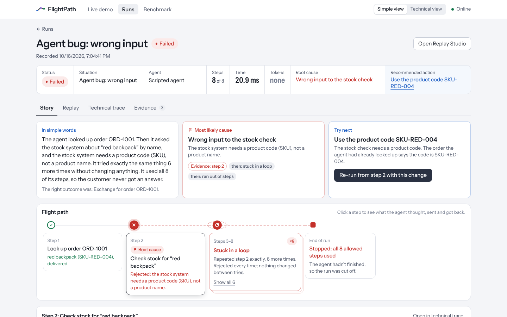
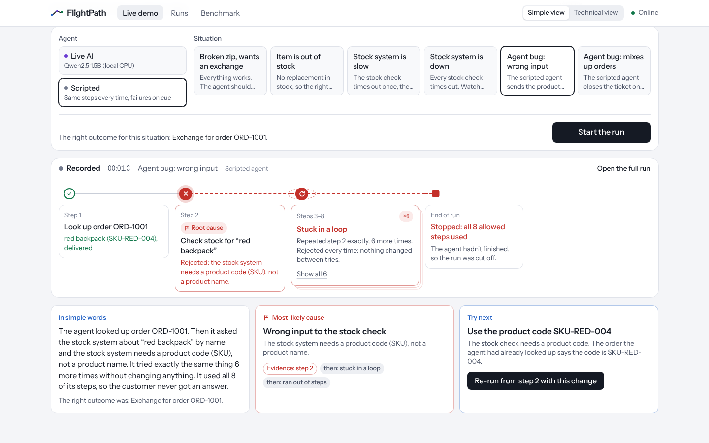
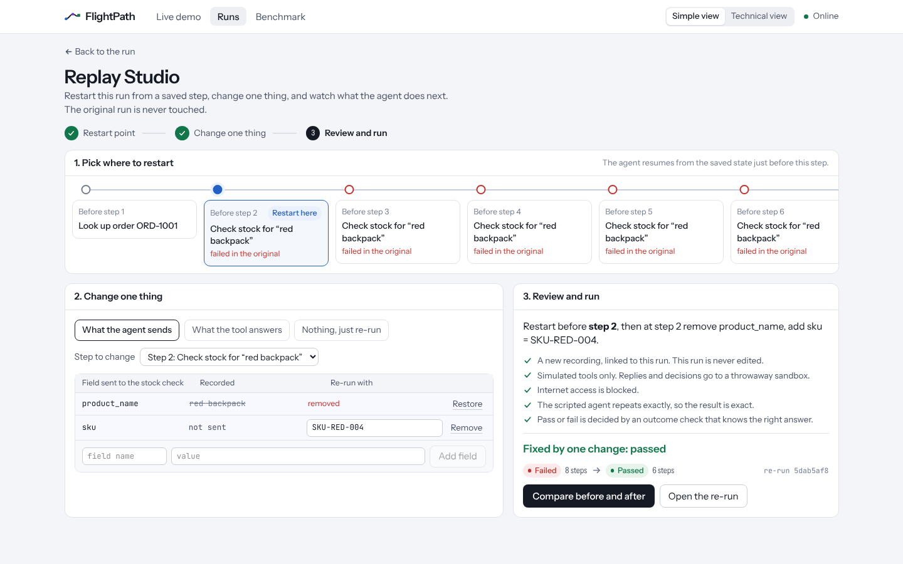
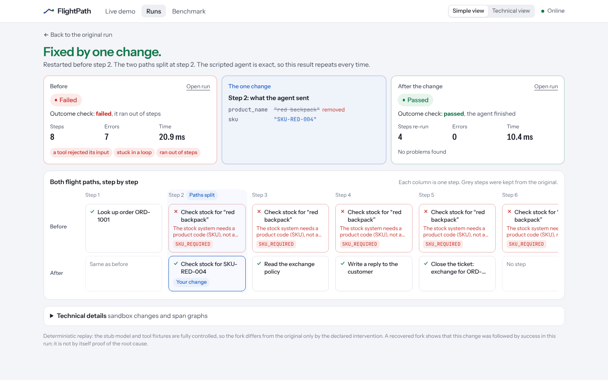
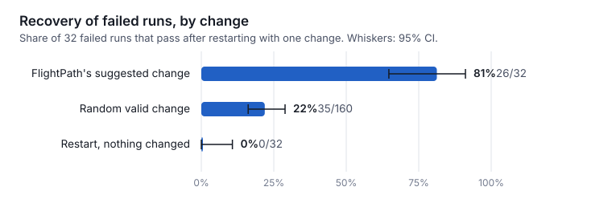
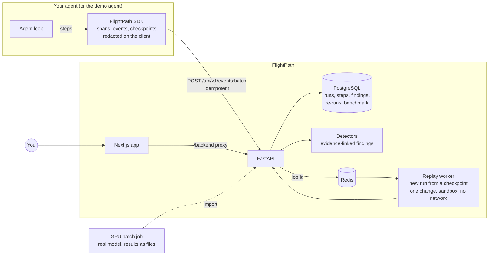
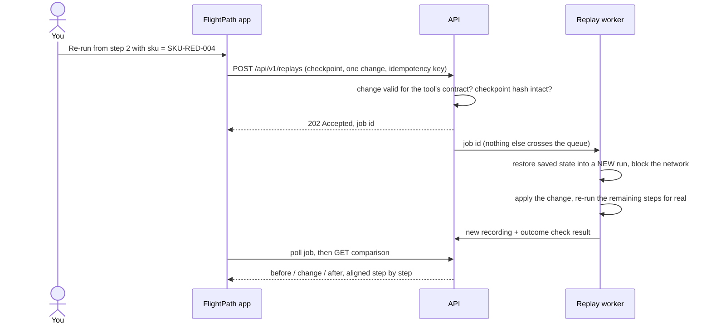

# FlightPath

**The flight recorder for AI agents.**

When an AI agent fails, logs show you an error or a wrong final answer. They don't show you
*the moment it went wrong*, *why*, or *whether a fix would actually work*. FlightPath
records every step an agent takes, points to the most likely root cause in plain words,
and lets you restart the run from that step with one change, safely, to prove the fix.



## What it answers

| Question | How FlightPath answers it |
|---|---|
| **What happened?** | Every step on one horizontal *flight path*: what the AI was thinking, what it sent to each tool, what came back. Identical failing attempts fold into one "stuck in a loop" block. An *In simple words* summary reads like a person wrote it. |
| **Why did it fail?** | Rule-based detectors that cite the exact steps they are based on. FlightPath ranks them: one **most likely cause**, the rest shown as its symptoms ("then: stuck in a loop", "then: ran out of steps"). |
| **What should I try next?** | A suggested change built only from what the run recorded (e.g. "use the product code SKU-RED-004 that the order lookup already returned"), runnable in one click. Or design your own in **Replay Studio**. |
| **Did the change fix it?** | The run restarts from a saved step as a **new** recording, in a sandbox with simulated tools and no network. An outcome check that knows the right answer decides pass or fail, never the agent. Before and after are shown side by side. |

| Live demo | Replay Studio | Before and after |
|---|---|---|
|  |  |  |

## Does the suggested change actually help? (benchmark)

52 synthetic support tickets in 8 families (3 kinds of controls, wrong tool inputs, a
looping lookup, a system that never answers, stale data, mixed-up customer orders), 16 of
them held out. Every failed run is restarted three ways (FlightPath's suggested change, a
random valid change, no change) and an outcome check that knows the right answer decides.
Two agents were tested: a scripted agent that makes the planted mistake on purpose, and a
real model, Qwen2.5-3B-Instruct, on a GPU (3 seeds per case).

| | Scripted agent | Qwen2.5-3B (real model) |
|---|---|---|
| Baseline success | 38% (20/52) | 79% (124/156) |
| Failed runs fixed by FlightPath's suggested change | **81%** (26/32) | 22% (7/32) |
| Fixed by a random valid change | 22% (35/160) | 22% (28/130) |
| Fixed by restarting with nothing changed | 0% (0/32) | 0% (0/26) |
| Failed runs where FlightPath proposed a change | 81% (26/32) | 22% (7/32) |
| ...and that change then worked | 100% (26/26) | **100%** (7/7) |
| Replays that reproduce the original run exactly | 100% (52/52) | 100% (150/150) |



**What the real-model run shows.** Qwen didn't make the planted mistakes at all: it read
product codes correctly, didn't loop and never mixed up orders. Its 32 failures were its
own:

- **17 stale data** (a month-old record says "out of stock", so it refunds instead of
  exchanging). FlightPath has no detector for stale data, so it proposed nothing.
- **7 a system that never answers.** Detected every time; FlightPath's change (answer as
  the system would have) fixed **7 of 7**, against 26% for random changes and 0% for no
  change.
- **8 others** in the refund, recovered-timeout and mixed-up-order cases. In 7 no
  detector fired; in 1 the model closed the ticket twice, which is detected but has no
  one-step fix.

So when FlightPath suggests a change, it works; the gap is **coverage**: on real-model
failures it recognised only 7 of 32. Overall it is no better than a random change (22% vs
22%) until it can see stale data and the other misses. That is the next milestone.

Intervals, per-family tables and definitions: [scripted](benchmark-results/benchmark_v1/scripted/summary.md),
[Qwen2.5-3B](benchmark-results/benchmark_v1/qwen2.5-3b-instruct/summary.md). Each is computed
from its `runs.jsonl` (one line per run). The scripted run rebuilds with `make benchmark`
in about ten seconds; the GPU run took 23 minutes on one GPU.

**Read it honestly.** The cases are synthetic and the detectors and repair rules were
written by the same team (against the demo fixtures, not these cases). A recovered run
shows that the change was followed by success; together with the two controls it is
evidence, not proof, of the root cause.

## How it works



A replay, step by step:



The source run is never modified (tested by fingerprinting its rows before and after).
Design details: [architecture](docs/architecture.md) and the
[replay contract](docs/replay-contract.md).

## Quickstart

Needs Linux or macOS, Python 3.11/3.12 and `make`. No Docker, root or conda: Postgres,
Redis and Node are installed from Python wheels into a project-local virtualenv.

```bash
git clone https://github.com/Kaushik2AI/agent-blackbox.git && cd agent-blackbox
make setup     # venv, Postgres/Redis/Node, web deps, .env with random passwords, migrations
make dev       # API + replay worker + web app; prints the URL to open
```

Open the URL, choose **Scripted** and **Agent bug: wrong input**, and press **Start the run**.

<details>
<summary>With Docker for Postgres/Redis instead</summary>

```bash
cp .env.example .env   # set the two passwords
python3.12 -m venv .venv && source .venv/bin/activate
make install && make compose-up && make dev
```
</details>

<details>
<summary>Live AI: a real Qwen model on your machine</summary>

```bash
make qwen-setup   # once: PyTorch + transformers + Qwen2.5, then a one-question self-test
make dev          # also starts a local model server; "Live AI" turns on when it has loaded
```

The model size follows the hardware: Qwen2.5-3B on a GPU with 12 GB or more, 1.5B on a
smaller GPU or a CPU with 10 GB free RAM, otherwise 0.5B. On a CPU expect 10–20 s per AI
step. Any OpenAI-compatible API works too: set `LLM_BASE_URL`, `LLM_API_KEY`, `LLM_MODEL`.
</details>

<details>
<summary>Running the app on a remote server</summary>

Only one port (the web port in `.env`) has to reach your browser; the API is proxied
behind it. With SSH: `ssh -L 3000:127.0.0.1:<WEB_PORT> server`. Behind a browser-based
VS Code (code-server), `make dev` detects the IDE's port proxy and builds the app for it;
see [the runbook](docs/developer-runbook.md).
</details>

## Benchmark and GPU evaluation

```bash
make benchmark          # 52 cases x 4 arms on CPU -> benchmark-results/benchmark_v1/scripted/
make benchmark-import   # load it into the app: Benchmark page, every run openable
```

With a real model on a GPU (resumable batch job; results are files, nothing listens on a
port):

```bash
make gpu-setup                       # once, with internet: CUDA PyTorch + model download
qsub infra/batch/sge_eval.sh         # Grid Engine
sbatch infra/batch/slurm_eval.sh     # or Slurm
make gpu-benchmark                   # or right here, on this machine's GPU
make benchmark-import BENCH_OUT=benchmark-results/benchmark_v1/qwen2.5-3b-instruct
```

Each run records the model and its resolved revision, decoding settings, seed, agent and
fixture versions, torch/CUDA versions, GPU and scheduler job id (never the host name).
Method and metric definitions: [docs/benchmark.md](docs/benchmark.md).

## Record your own agent

```python
import uuid

from blackbox_sdk.exporters import HttpExporter
from blackbox_sdk.recorder import Recorder, Resource

rec = Recorder(
    resource=Resource(project="my-team", agent="refund-bot", git_sha="abc1234",
                      config_hash="prompt-v3", model_name="qwen2.5-7b-instruct"),
    execution_id=str(uuid.uuid4()), task_id="refund-ticket-42",
    capture_content=True,  # default False: field names and value shapes only
)
root = rec.start_span("invoke_agent refund-bot", "agent")
tool = rec.start_span("execute_tool lookup_order", "tool", parent=root)
rec.add_event(tool, "tool_call_end", status="error", tool_name="lookup_order",
              payload={"input_redacted": rec.capture({"order_id": "a-1001"}),
                       "error_code": "ORDER_NOT_FOUND"})
rec.end_span(tool, "error"); rec.end_span(root, "error"); rec.finish("failed")
for batch in rec.to_batches():
    HttpExporter("http://127.0.0.1:8000").export(batch)
```

Runnable version: [`examples/record_your_agent.py`](examples/record_your_agent.py).
Re-running from a checkpoint needs a harness that can resume from saved state (the demo
agent can); recording and diagnosis work for any agent.

## Repository

| Path | What it is |
|---|---|
| `apps/web` | Next.js app: live demo, runs, run page (story, replay, trace, evidence), Replay Studio, comparison, benchmark |
| `apps/api` | FastAPI: ingest, read APIs, findings, replay orchestration, benchmark import; Alembic migrations |
| `packages/agent_harness` | Demo support agent (LangGraph), simulated tools with contracts, fixtures, outcome check, checkpoint resume |
| `packages/blackbox_sdk` | Recording SDK: OpenTelemetry-style spans and events, redaction, exporters |
| `packages/analysis_engine` | Rule-based failure detectors with evidence |
| `packages/evaluation` | Benchmark cases, the four arms, metrics with intervals, reports, GPU model adapter |
| `infra/local` | No-Docker setup and services, local model server |
| `infra/batch` | GPU job scripts (Grid Engine, Slurm) |
| `benchmark-results` | Committed benchmark output (runs, summary, charts) |
| `docs` | Architecture, replay contract, data model, threat model, design, benchmark method |

## Quality checks

```bash
make check       # ruff + mypy --strict + tsc, all unit/integration tests, production build
make test-e2e    # with `make dev` running: 7 browser tests (Playwright)
```

Tests: 53 agent harness, 17 SDK, 10 detector, 67 benchmark, 88 API (against real
Postgres and Redis), 22 web unit, 7 browser. Highlights: the source run is byte-for-byte
unchanged after a replay; tampered checkpoints are refused; network access during a replay
fails the job; the benchmark rebuilds identical results from scratch and resumes without
duplicates; metric denominators are tested against hand-computed values.

## Limitations

- **No authentication yet.** Run it on your own machine or behind an authenticated proxy;
  don't expose the API port on a network.
- Re-runs work for the included demo agent, whose state can be saved and resumed.
  Your own agent can be recorded and diagnosed, but not yet re-run.
- Detectors are rules, and the benchmark is synthetic. Stale data and wrong decisions
  aren't detected yet, which is most of what a real model gets wrong (see above).
- The network block during replays is in-process (Python sockets), not an OS sandbox.
- The scripted agent is a deterministic stand-in for an LLM; the Live AI and GPU paths use
  a real model.

## Status

| | Milestone | |
|---|---|---|
| M0–M4 | Spec, infrastructure, demo agent, SDK and ingest, run inspector | done |
| M5–M7 | Detectors, checkpoint replay engine, Replay Studio and comparison | done |
| UI | FlightPath redesign: flight path, plain-language answers, simple/technical views | done |
| M8 | Benchmark: 52 cases, 4 arms, intervals, held-out split, artifacts, dashboard | done |
| M9 | GPU evaluation: Qwen2.5-3B on a GPU, 156 runs, results above | done |
| M10 | Stale-data and wrong-decision detection (the coverage gap found in M9) | next |
| M11 | Authentication, hardening, public deployment | planned |

## Docs

- [Architecture](docs/architecture.md)
- [Replay contract](docs/replay-contract.md)
- [Data model](docs/data-model.md)
- [Threat model](docs/threat-model.md)
- [Benchmark method](docs/benchmark.md)
- [Developer runbook](docs/developer-runbook.md)
- [UX redesign](docs/design/flightpath-redesign.md) and [next product ideas](docs/design/flightpath-next.md)
- [ADR-001: core stack](docs/decisions/ADR-001-core-stack.md)

Apache-2.0 licensed.
