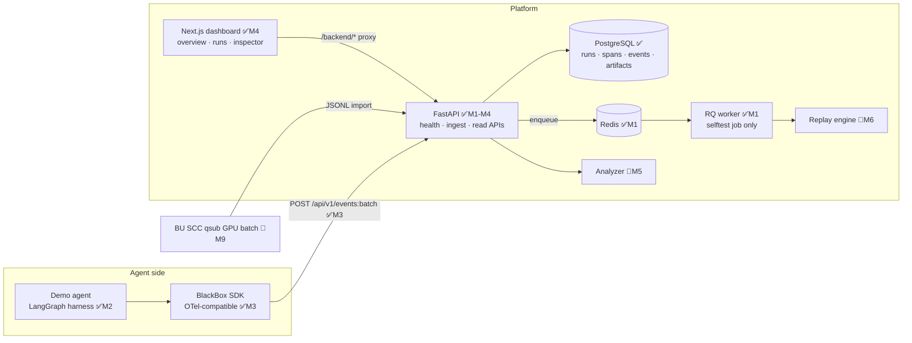
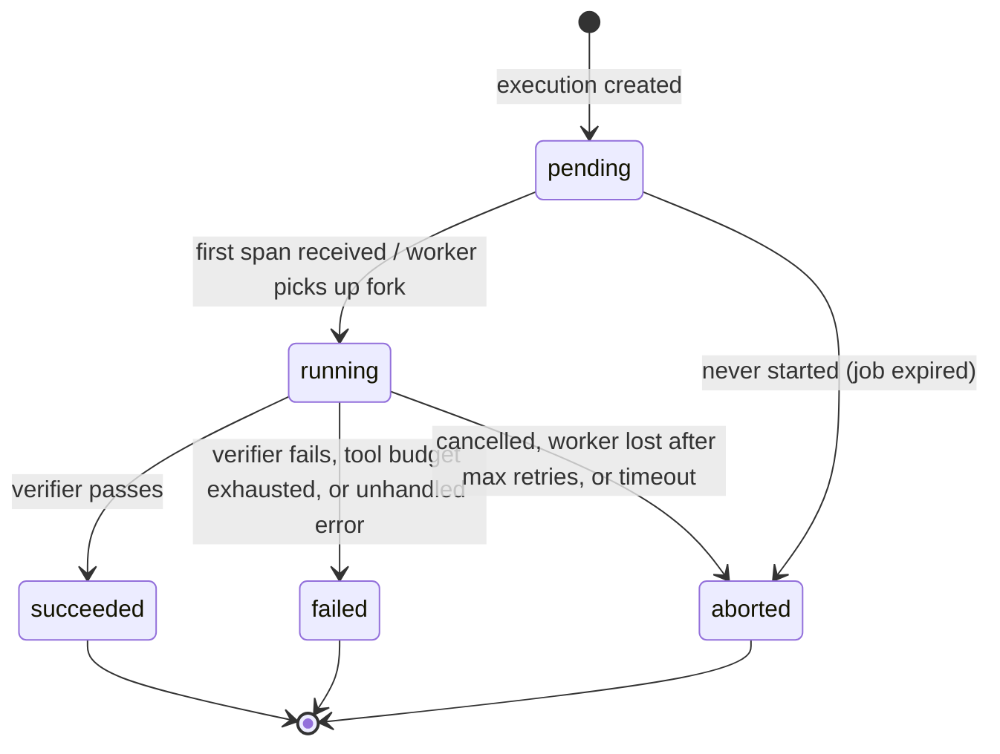
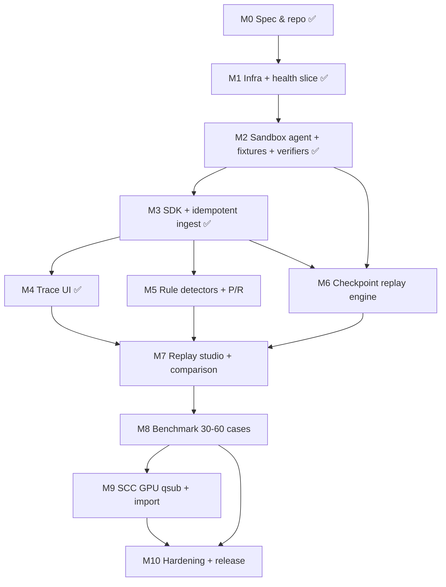

# Architecture

> Status legend: ✅ implemented and tested · 🚧 specified, not built yet (milestone noted)

## 1. Components

### Boundary rules (enforced by design, tested as each piece lands)

1. The browser never talks to Postgres or Redis; Next.js never talks to Postgres.
2. The browser talks only to the Next.js port; FastAPI is reached through the
   server-side `/backend` rewrite (`apps/web/next.config.ts`).
3. Ingestion never executes agent code. Only the replay worker runs agent code, and only
   with allowlisted sandbox tools (M6).
4. LLM-written analysis is untrusted text: rendered as text, never executed.
5. GPU work goes through the SCC scheduler as batch jobs, never inside a web request.

## 2. Request flow (target, by milestone)

1. Agent starts an execution: `execution_id`, `agent_version`, immutable
   `environment_fingerprint` (M2/M3).
2. SDK emits spans/events with trace/span IDs and **monotonic `sequence_no`** (M3).
3. API validates schema version, size, project ownership; redacts; stores idempotently on
   `event_id` (M3).
4. UI loads graph/timeline via paginated APIs (M4).
5. Analyzer writes evidence-linked findings; optional LLM text is labelled *hypothesis* (M5).
6. Replay request is validated (checkpoint eligible, intervention schema-valid, target after
   checkpoint) and enqueued; API answers `202` + job id (M6).
7. Worker restores the checkpoint into a **new** execution, applies exactly one
   intervention, runs the suffix with sandbox tools, records a fresh trace (M6).
8. Ground-truth verifier scores the fork from final sandbox state; comparison stored (M6/M7).

## 3. Execution lifecycle

- Terminal states are **final and immutable**. A replay never edits its source; it creates
  a new execution with `parent_execution_id` set (DB check forbids self-parenting ✅).
- `succeeded`/`failed` come from the **ground-truth verifier**, never from the model's own
  claim of success.
- `status` is a Postgres enum (`execution_status`) ✅.

## 4. Screen-by-screen UX specification

| # | Screen | Milestone | Data source | Must show | Empty / error state |
|---|---|---|---|---|---|
| 0 | **System status** | ✅ M1 | `/healthz`, `/readyz` | API env, Postgres migration head + latency, Redis PONG + latency, last-checked time | "API unreachable" with the real reason; "dependency not ready" with per-check detail |
| 1 | **Overview** | ✅ M4 | executions aggregate API | total runs, success rate, top failure categories, median latency, token spend; filters (version/date/outcome/model) | "No runs yet — run `make seed-demo`" |
| 2 | **Runs explorer** | ✅ M4 | `GET /api/v1/executions` | status, task, run ID, version, duration, cost estimate, failure tags; pagination; keyboard nav | no-match filter message; network error with retry |
| 3 | **Execution inspector** | ✅ M4 | `/timeline`, `/graph` | React Flow DAG (zoom, clickable), ordered timeline, event inspector with **redacted** payloads, error + stack, parent/child spans | spans missing parents shown as orphans, not dropped |
| 4 | **Findings panel** | M5 | `/findings` | category, severity, detector version, links to evidence events; LLM text badged **Hypothesis** | "No rule fired" (not "healthy") |
| 5 | **Replay studio** | M7 | `/checkpoints`, `POST /replays`, `GET /replays/{id}` | only eligible checkpoints; one intervention (type, target call, schema-validated editor); sandbox badge; confirm dialog; async progress | replay button **disabled** with reason when no eligible checkpoint |
| 6 | **Comparison** | M7 | `/replays/{id}/comparison` | side-by-side graphs, the exact intervention record, JSON diff, verifier outcome, latency/calls/tokens/cost; replay class (`deterministic` / `controlled_stochastic` / `best_effort`) | fork still running → progress; fork failed → shown honestly |
| 7 | **Evaluation lab** | M8 | `/evaluations` | benchmark, baselines vs intervention, denominators, CIs, export JSON/CSV | numbers only from result files |
| 8 | **Integration page** | M10 | project/API-key APIs | copyable SDK snippet; API key shown once at creation | — |

Global UI rules: dark theme, keyboard accessible, responsive to phone width, no hardcoded
metrics, loading/empty/error states on every data view.

## 5. Milestone task graph

**MVP = M0–M7** (deterministic stub model, 3–10 fixtures). M8–M10 extend evaluation,
GPU experiments and polish. Exit gates for each milestone are in
[`acceptance-matrix.md`](acceptance-matrix.md).
